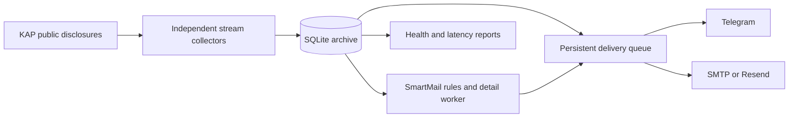

# KAP Bildirim

A lightweight Python service that monitors public disclosures from Türkiye’s Public Disclosure Platform (KAP), archives them in SQLite, and delivers alerts through Telegram and email.

Built for a small Linux VPS using the Python standard library. No external Python packages, Docker, Redis, or separate database server are required.

## What it does

- Monitors company/institution and fund disclosure streams with independent workers.
- Uses disclosure IDs for deduplication and a persistent delivery queue for retries after restarts.
- Reconciles overlapping date windows and resumes collection after interruptions.
- Supports Telegram private channels, SMTP, and Resend email delivery.
- Offers optional **SmartMail** rules for critical-event prioritization, negation handling, and financial-materiality checks when validated context is supplied.
- Supports shadow mode and offline backtesting before enabling SmartMail alerts.
- Includes health reporting, delivery-latency measurements, rotating logs, systemd units, and SQLite backups.

## Architecture



SmartMail’s critical-event path is deterministic and does not call an LLM. AI commentary and scheduled digest delivery are not implemented in this version.

## Quick start

Requires **Python 3.9+** and operating-system timezone data. Run from the repository root:

```bash
git clone https://github.com/ceylanal/kap-bildirim.git
cd kap-bildirim
cp .env.example .env
python3 -m unittest discover -s tests -v
python3 -m kapwatch --env-file .env collect-once
python3 -m kapwatch --env-file .env health
python3 -m kapwatch --env-file .env preview
```

Notifications are disabled in the example configuration. These collection commands use the local `data/` directory. The first successful collection establishes a baseline and does not flood the destination with historical alerts.

For continuous collection:

```bash
python3 -m kapwatch --env-file .env run
```

## Enable delivery

Keep tokens, passwords, destination IDs, and recipient addresses in `.env` or a protected server environment file. `.env.example` lists the supported settings.

**Telegram:** create a bot with BotFather, add it to your private channel with permission to post messages, and set `TELEGRAM_BOT_TOKEN`, `TELEGRAM_CHAT_ID`, and `TELEGRAM_ENABLED=true`. The CLI includes `telegram-info` and `send-test` commands.

**Email:** configure SMTP or follow the [Resend setup](RESEND_SETUP.md). Set the sender and recipient explicitly before enabling delivery.

**SmartMail:** read the [rule engine and validation notes](SMARTMAIL.md), start with `SMARTMAIL_MODE=shadow`, and review recorded decisions before choosing a delivery mode.

## Offline evaluation

Fixtures include labeled historical public KAP disclosures and synthetic cases. Labels and their rationale are recorded in the fixture manifests.

```bash
python3 -m kapwatch smartmail-backtest tests/fixtures/smartmail/historical.jsonl --output reports/smartmail-historical-full.json
python3 -m kapwatch smartmail-backtest tests/fixtures/smartmail/validation.jsonl --output reports/smartmail-validation-full.json
```

Results are specific to these small fixtures. They do not establish accuracy across all disclosures; the detailed documentation records limitations and labeling assumptions.

## Linux deployment

Copy the project to `/opt/kap-bildirim` on your own Linux server, then run:

```bash
sudo bash deploy/install.sh
```

The installer creates a dedicated service user, a protected `/etc/kap-bildirim.env`, a persistent data directory, and systemd service/health/backup timers. It preserves an existing environment file. Review the scripts and configure your destinations before enabling live delivery.

```bash
systemctl status kap-bildirim --no-pager
journalctl -u kap-bildirim -n 30 --no-pager
systemctl list-timers 'kap-bildirim-*' --no-pager
```

## Scope and limitations

This project uses KAP’s public web interface. It is **not the official subscription-based KAP Data Publication Service**. Public endpoints and formats may change. Collection respects source backoff and access errors; it does not bypass access controls.

Polling defaults to 15 seconds, with a longer reconciliation interval. Delivery time depends on the source, network, workload, and notification provider. Provider acceptance does not guarantee inbox delivery or that a person has read the message. Network ambiguity can lead to duplicate delivery. PDF attachments are not parsed in this version.

The repository contains application code, public/synthetic test fixtures, and example configuration. Local databases, credentials, private channel details, and production operations records are excluded.

## Project layout

| Path | Purpose |
| --- | --- |
| `kapwatch/` | Collection, persistence, rules, backtesting, and delivery |
| `config/` | SmartMail rules and example financial context |
| `tests/` | Automated tests and labeled fixtures |
| `deploy/` | Linux service, health, backup, and upgrade scripts |
| `tools/` | Rule compilation, historical capture, and configuration helpers |
| `reports/` | Offline evaluation outputs |

[Public KAP website](https://www.kap.org.tr/tr)
