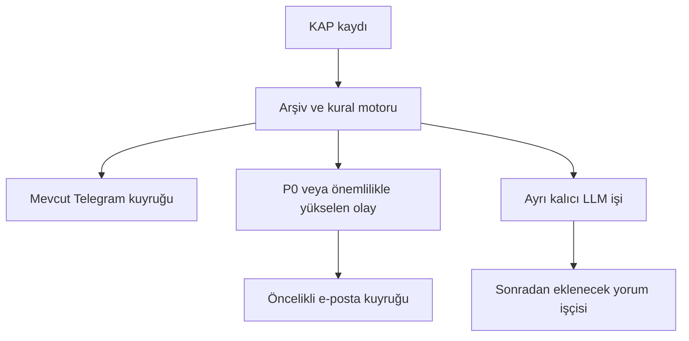

# KAP SmartMail kural motoru ve doğrulama

12 Ekim 2026. Mevcut Telegram botunun üzerine deterministik bir e-posta
yönlendirme katmanı, sürekli tam metin işçisi ve gölge mod eklendi. Üç mimari kural yerel uygulamada karşılanır:
P0 için LLM beklenmez, önemlilik oranı Python ile hesaplanır ve etiketli geçmiş
bildirimler çevrimdışı tekrar oynatılarak yanlış pozitif ve kritik kaçırma ölçülür.

## Gönderim akışı



P0, sayısal finansal bağlam veya LLM sağlayıcısı gerektirmez. Belirsiz statü veya
etkilenen taraf durumunda kaynak cümle ile birlikte manuel inceleme bayrağı
gönderilir. Olumsuzlanan cümleler bastırılır; planlı bakım duruşları P2'ye indirilir.
Bağımsız başka bir kritik cümle varsa olumsuzlama veya bakım onu bastırmaz.
JSON/YAML'deki fiyat yönü açıklamaları fiyat tahmini olarak kullanılmaz.

E-posta gönderiminde P0, P1 ve rutin kuyruk sırası uygulanır. Sağlayıcının hata
beklemesi ve hız sınırları korunur. Aynı SMTP gönderimi başladıysa geri alınamaz.
Gönderim API/SMTP kabulünü ölçer; posta kutusuna ulaşma ve okunma garantisi vermez.

LLM işi `smartmail_llm_jobs` tablosuna yazılır. Bu sürümde LLM çağrısı yapan işçi
yoktur; işlerin beklemesi P0 e-postasını durdurmaz. AI finansal yorumu için daha
sonra ayrı sağlayıcı işçisi eklenir. Günlük bülten göndericisi de henüz yoktur;
P1/P2/P3 ve bastırılmış sonuçlar `smartmail_assessments` tablosunda saklanır.

## Yapılandırma

Olay sözlüğü `config/kap_smartmail_rules_v1.yaml` dosyasında tanımlıdır. Çalışan Python servisi ek paket istememek
için bunun derlenmiş JSON karşılığı `config/smartmail_rules.json` dosyasını okur.
YAML değiştirildikten sonra geliştirici ortamında:

```bash
ruby tools/compile_smartmail_rules.rb config/kap_smartmail_rules_v1.yaml config/smartmail_rules.json
```

Ruby yalnızca derleme içindir; sunucuda JSON dosyası yeterlidir. Öncelik ve
önemlilik ayarları JSON'da da değiştirilebilir; iki dosyanın uyumu korunmalıdır.

Yeni ayarlar `.env.example` içinde bulunur. `SMARTMAIL_ENABLED=false` varsayılanı
mevcut Telegram/e-posta davranışını korur. Etkinleştirildiğinde normal Telegram
kapsamı korunur; e-posta kapsamını `SMARTMAIL_MODE` belirler. Sağlayıcı ve alıcı bilgileri yerel ortam dosyasından okunur.
Kurulum adımları için [Resend kurulumu](RESEND_SETUP.md) belgesine bakın.

## Sayısal önemlilik

`toplam sözleşme tutarı / doğrulanmış yıllık ciro > 0.20` ise yeni iş olayı
P2'den P1'e yükseltilir ve `live` modunda e-posta kuyruğuna alınır.
Mevcut `p0` modunda karar kaydedilir. Tam %20 yükseltilmez.
`new_business_revenue_ratio_threshold` ve hedef öncelik değiştirilebilir.
Bu değer yasal eşik veya kesin fiyat etkisi göstergesi değildir.

Örnek: 12 milyar TL / 50 milyar TL = %24. Bu yalnızca test senaryosudur.
Sözleşmenin toplam tutarının bir yıllık ciroya oranıdır; çok yıllı sözleşmenin
tek yılda gelir yazılacağını veya %24 büyüme sağlanacağını söylemez.

Hesap için pozitif tutar, aynı para birimi, aynı konsolidasyon kapsamı,
doğrulanmış kaynak ve bildirim anında bilinen yaklaşık bir yıllık ciro gerekir.
Finansal verinin açıklanma zamanı olaydan sonraysa geçmiş testte kullanılmaz.
Varsayılan veri yaş sınırı dönem sonundan 540 gündür. Kur çevrimi yapılmaz;
birden fazla farklı tutardan en büyüğü seçilmez. KDV dahil metinsel tutar
veya belirsiz kapsam otomatik yükseltme yapmaz. Eksik veri için oran boş kalır
ve manuel inceleme işaretlenir.

Finansal veri `SMARTMAIL_FINANCIAL_CONTEXT_FILE` ile verilen JSON'dan okunur;
şema örneği `config/financial_context.example.json` içindedir. Örneğin sayıları
gerçek şirket verisi olarak kullanmayı önlemek için `companies` alanı boştur.
Bu sürüm otomatik bilanço/TTM ciro toplamaz. KAP/XBRL adaptörü veya kaynağı
kontrol edilmiş veri girişi olmadan canlı sayısal yükseltme oluşmaz.

## Tekrar ve düzeltmeler

Telegram'ın bildirim numarasına göre tekrar kontrolü korunur. SmartMail e-posta
anahtarı bildirim numarası ile olay/statü/önemlilik revizyonunu
birleştirir. Aynı olay tekrar gönderilmez; yeni statü veya önemli düzeltme yeni
uyarı olabilir. Eski bekleyen uyarı güncellenirse iptal edilir. Daha önce
gönderilmiş e-posta geri alınamaz. Erişime kapatılan kayıtların bekleyen e-postaları
ve LLM işleri iptal edilir. Ağ sonucu belirsizse taşıma katmanında mükerrer
teslim ihtimali vardır; tam bir exactly-once teslim garantisi verilmez.

## Geçmiş doğrulama

Resmî KAP sayfalarından 8 bildirim kaydedildi; 4 kritik, 4 kritik olmayan örnek
konkordato, iflas, planlı bakım ve genel kurul/yönetim kurulu metinlerini kapsar.
Etiketler `tests/fixtures/smartmail/historical_manifest.json` içinde gerekçeleriyle
yer alır. Snapshot'lar `historical.jsonl` içindedir; İngilizce gizli hücreler ve
standart yasal beyan bu sayfaların kural girdisine alınmadı. PDF ekleri indirilmedi.
Etiketler tek incelemeye dayanır; bağımsız uzman doğrulaması yapılmadı.

```bash
python3 -m kapwatch smartmail-backtest tests/fixtures/smartmail/historical.jsonl --output reports/smartmail-historical-full.json
python3 -m kapwatch smartmail-backtest tests/fixtures/smartmail/historical.jsonl --title-summary-only --output reports/smartmail-historical-summary.json
python3 -m unittest discover -s tests -v
```

Backtest veri tabanı açmaz, Telegram/SMTP/LLM istemcisi oluşturmaz ve ağ isteği
yapmaz. Etiketsiz kayıtlarla başarı oranı üretmez; tarihsel ve sentetik örnekleri
aynı toplamda karıştırmaz. Payda sıfırsa oran `null` olur.

| Girdi | TP | FP | FN | TN | Yanlış pozitif FP/(FP+TN) | Kritik kaçırma FN/(TP+FN) |
|---|---:|---:|---:|---:|---:|---:|
| Tam metin dahil | 4 | 0 | 0 | 4 | %0 | %0 |
| Yalnızca başlık ve özet | 1 | 0 | 3 | 4 | %0 | %75 |

Bu oranlar seçilmiş 8 örneğin sonuçlarıdır. Rastgele veya temsilî test kümesi
değildir; kuralları geliştirmek için de kullanıldı. Kör test, 32 olay türünün
tam kapsamı ve üretim doğruluğu iddiası değildir. Özellikle planlı bakım
örneklerinin bir kısmında eşleşme hiç oluşmadı; bu, tüm bakım bağlamlarının
doğru ayrıştırıldığını göstermez. Ayrı bir zaman döneminden, olay türü ve şirket
çeşitliliği olan bağımsız etiketli veri kümesiyle test genişletilmelidir.

## Sürekli tam metin toplama ve gölge mod

Yeni şirket/kurum bildirimleri için kalıcı detay işi oluşturulur. KAP'ın kendi
bildirim sayfasındaki Türkçe metin ve resmî denetim görüşü alanı okunur. Detay
işçisi, toplayıcı ve Telegram/e-posta gönderim işçilerinden ayrıdır. Bir HTTP
isteği veya SMTP zaman aşımı diğer kanalı bekletmez. Şirket ve fon liste
sorguları da bağımsız işçilerde çalışır. PDF ekleri henüz okunmaz;
KAP sayfasındaki denetim görüşü AC/OS ise PDF veya AI beklemeden P0 bulunabilir.

Detaylar ayrı tabloda saklanır; liste kaydının kaynak revizyonu değiştirilmez.
Sonraki tarama tam metni silmez veya aynı işi yeniden başlatmaz. Kaynak kayıt
bu sırada değişirse eski revizyona ait detay sonucu kabul edilmez. Aynı
olay/statü için detayın yeni kaynak cümlesi tekrar e-posta oluşturmaz; yeni statü
veya önemlilik değişikliği yeni uyarı olabilir.

Varsayılan kapsam `SMARTMAIL_DETAIL_STREAMS=members` ile şirketler/kurumlardır.
Fonların Telegram takibi sürer; tam metinleri istenirse `members,funds` ile
kapsama alınabilir. Detay istekleri canlı hızlı pilotta 2 saniye aralıkla ve Türkiye gününe göre
2000 istek/gün üst sınırıyla yapılır. Sınırdaki işler atılmaz, bekler; sağlık
raporu iş sayısını ve bekleme yaşını gösterir. 401/403/666 erişim kısıtları en az
bir saat bekletir; 429 Retry-After korunur. Koruma mekanizmaları aşılmaz.

`SMARTMAIL_ENABLED=true` iken üç mod bulunur:

| Mod | Davranış |
|---|---|
| `shadow` | Kararlar ve gönderilecek e-posta metni saklanır; e-posta gönderilmez. |
| `p0` | Yalnızca P0 e-postaları gönderilir; diğer kararlar saklanır. |
| `live` | P0 ve sayısal önemlilikle yükselen diğer flash kararları gönderilir. |

Gölge modda e-posta sağlayıcısı yapılandırılmış olsa bile e-posta teslim hedefleri
boştur. Gölge kararları sonradan topluca gönderilmez. Başlık/özetteki P0 karar
hemen alınır; yalnızca detayda bulunan P0, detay indirildikten sonra oluşur.
Belirsiz aktör/statü manuel inceleme etiketiyle gösterilir.

```bash
python3 -m kapwatch --env-file /etc/kap-bildirim.env smartmail-report --limit 20
python3 -m kapwatch --env-file /etc/kap-bildirim.env health
```

Servis duruyorken `smartmail-seed-details --limit 10` mevcut arşivden sınırlı
sayıda doğrulama işi ekleyebilir. Bunlar tarihsel olarak işaretlenir; `p0` modunda
bile eski bildirimler için e-posta gönderilmez. Üretim kuyruğuna çevrimdışı test
bildirimi eklenmez.

## Ek doğrulama ve P0 e-posta kurulumu

Yeni `validation_manifest.json`/`validation.jsonl` kümesi 7 ek gerçek KAP örneği
ve etiket gerekçesi içerir. Sürekli adaptörün aynısıyla kaydedildi; 2 resmî
denetim görüşü P0 ve 5 planlı bakım örneği bulunur. Bu kümede 2 TP, 0 FP,
0 FN ve 5 TN ölçüldü. Sonuç `reports/smartmail-validation-full.json` içindedir.
Önceki 8 örnekten ayrıdır; seçilmiş ve küçük bir kümedir, bağımsız uzmanla
etiketlenmiş temsilî doğruluk testi değildir. Ek denetim görüşü desteği eklenirken
kaynakları incelendiğinden kör test olarak da sunulmaz.

P0 e-postası için `EMAIL_PROVIDER=resend` ile API anahtarı, gönderici ve alıcı;
veya `EMAIL_PROVIDER=smtp` ile SMTP sunucusu, TLS türü/portu ve kimlik bilgileri
`/etc/kap-bildirim.env` dosyasına girilir. SMTP parolası/API anahtarı yalnızca
bu gizli dosyada saklanır; sohbete veya komut satırına yazılmaz. Telegram
anahtarı korunur. Önce gölge modda şu komut yalnızca alıcıya deneme maili gönderir:

```bash
python3 -m kapwatch --env-file /etc/kap-bildirim.env send-test-email
```

Sağlayıcının kabulü doğrulandıktan sonra `SMARTMAIL_MODE=p0`, `EMAIL_ENABLED=true`
olarak servis yeniden başlatılır. Gölge modda toplanmış eski kararlar gönderilmez.
Yeni P0 kaynak cümlesi ve KAP bağlantısıyla iletilir. Seçilen sağlayıcının
kimlik bilgileri eksikse canlı P0 e-posta teslimi tamamlanmış sayılmaz.

Resend ve `p0` modu için sağlayıcı ayarları
[Resend kurulumu](RESEND_SETUP.md) belgesinde açıklanır.

Canlı hızlı pilotta liste taraması 15 saniyedir; 180 saniyede bir önceki günle
örtüşen sorgu geç gelen kayıtları ve düzeltmeleri yakalar. Liste zaman aşımı
ayrı olarak 8 saniyedir; erişim kısıtlarının bekleme süreleri korunur.
"Derhal" kaynak kaydının alınması/kural tespitinden sonra kuyruğa yazılmasını
anlatır. 10–20 saniye hedefi garanti değildir; yayın, tespit ve sağlayıcının
kabul zamanı ölçülür. P0 yalnızca tam metinde tespit edilirse detay kuyruğu ve
isteği de bu süreye eklenir. Yoğun Telegram kuyruğunda P0 öne alınır;
1,2 saniyelik kanal gönderim aralığı korunur.
